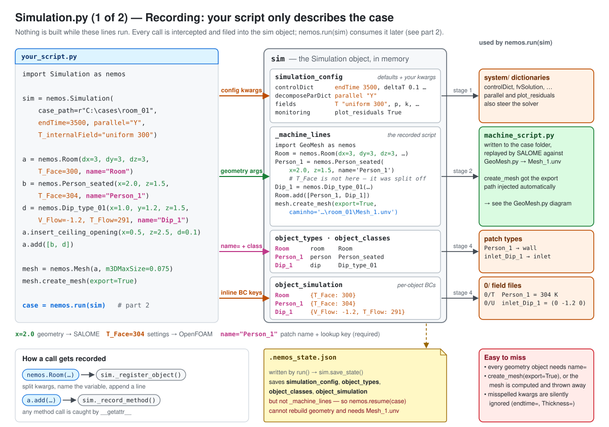
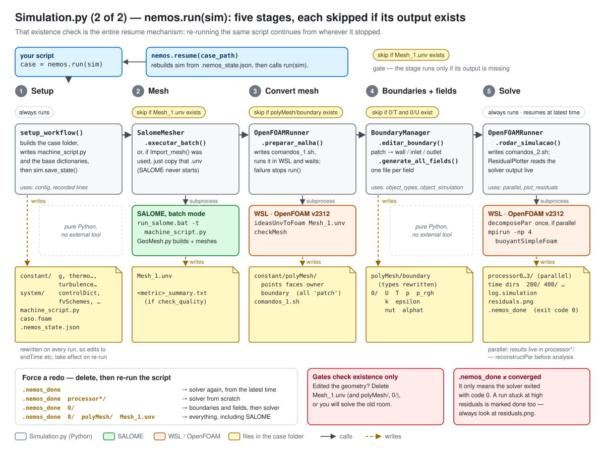
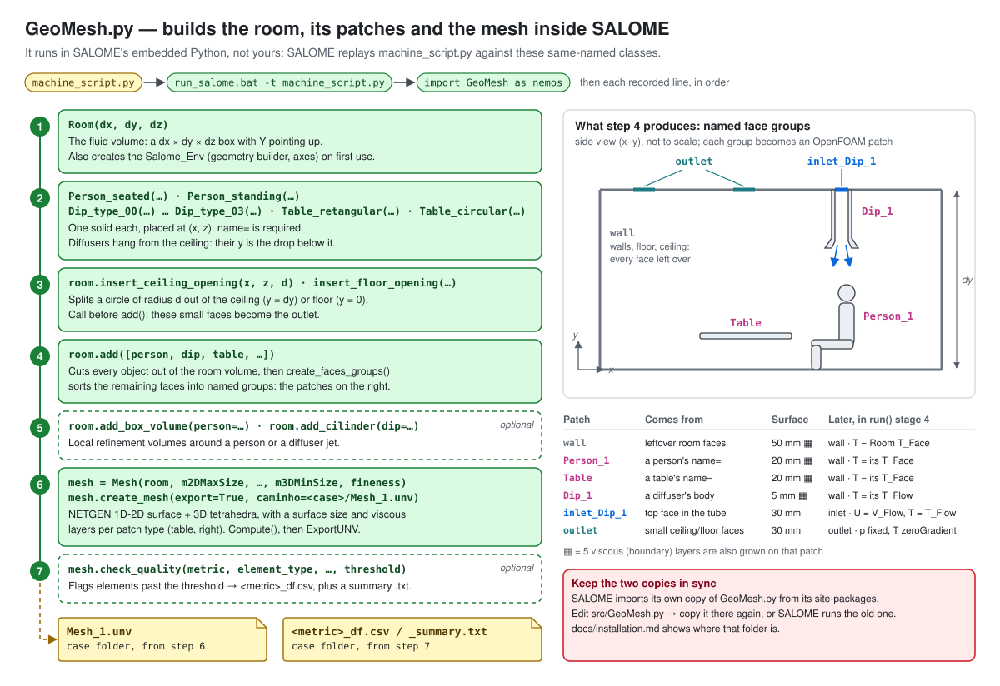
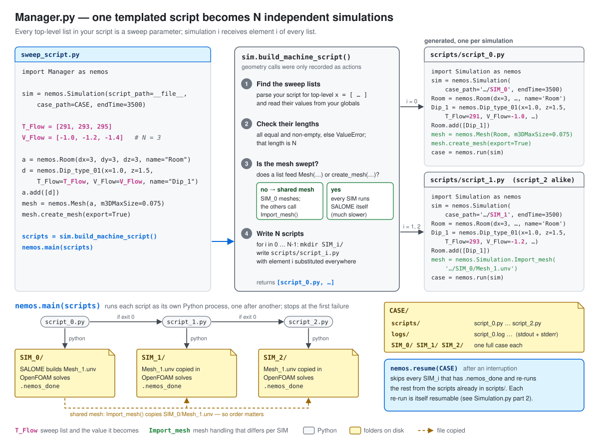
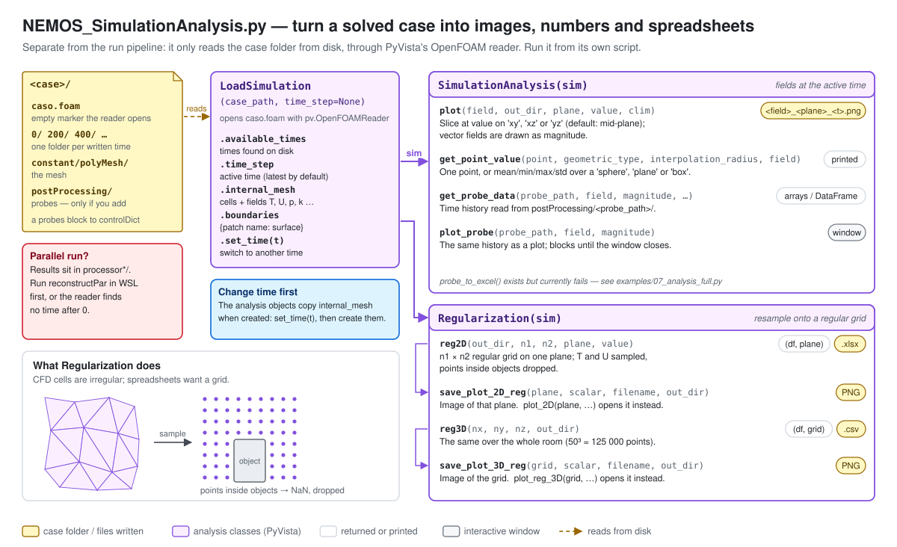
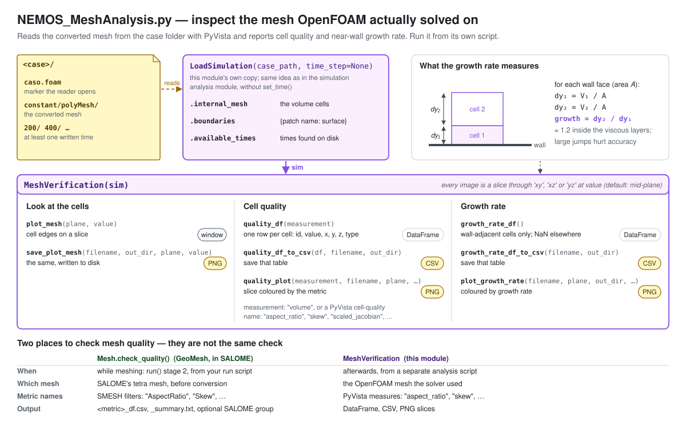
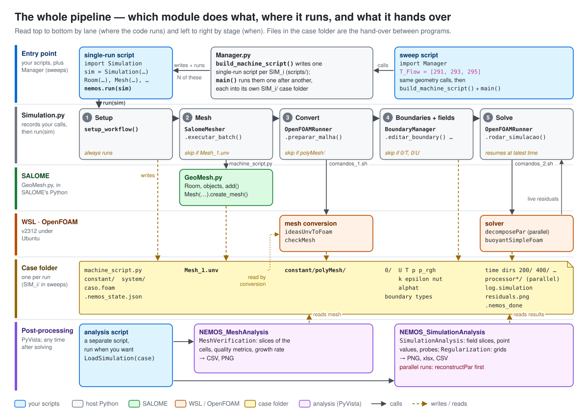

# Diagrams

Visual companions to [workflow.md](../workflow.md) and
[api-reference.md](../api-reference.md). Each module gets its own diagram
first; the last one puts them together into the whole pipeline. If you want
the big picture before the details, start with [6](#6-the-whole-pipeline).

The same colours mean the same thing in every diagram:

| Colour | Means |
|---|---|
| Blue | Your scripts |
| Grey | Host Python (`Simulation.py`, `Manager.py`) |
| Green | SALOME, running `GeoMesh.py` |
| Orange | WSL / OpenFOAM |
| Amber | Files in the case folder |
| Purple | Post-processing (PyVista) |

Solid arrows are calls; dashed amber arrows are files being written or read.

---

## 1a. `Simulation.py` — recording

Nothing is built while your script runs. Each geometry call is split three
ways: geometry arguments go into the recorded SALOME script, `T_Face` /
`T_Flow` / `V_Flow` are kept per object for the boundary conditions, and
`name=` links the two, because it becomes the OpenFOAM patch name.

## 1b. `Simulation.py` — `nemos.run(sim)`

Five stages, each skipped if its output file already exists. That check is
the whole resume mechanism, and it's also why editing geometry does nothing
until you delete `Mesh_1.unv`.

## 2. `GeoMesh.py`

The code that actually builds geometry, inside SALOME. `room.add()` is the
step that turns objects into named patches; the table shows how each patch
is meshed and which boundary condition it later receives.

## 3. `Manager.py`

Every top-level list in the script is a sweep parameter. Manager writes one
ordinary single-run script per simulation and runs them in order. When the
mesh isn't swept, `SIM_0` meshes and the others copy its mesh.

## 4. `NEMOS_SimulationAnalysis.py`

Reads a solved case from disk. `SimulationAnalysis` works on the fields at
the active time; `Regularization` resamples them onto a regular grid for
spreadsheets. Call `set_time()` *before* creating either.

## 5. `NEMOS_MeshAnalysis.py`

Quality and near-wall growth rate of the mesh OpenFOAM solved on. Not the
same check as `Mesh.check_quality()` in SALOME: the table at the bottom
spells out the difference.

## 6. The whole pipeline

Lanes are where code runs, columns are when. Every hand-over between
programs goes through a file in the case folder.
