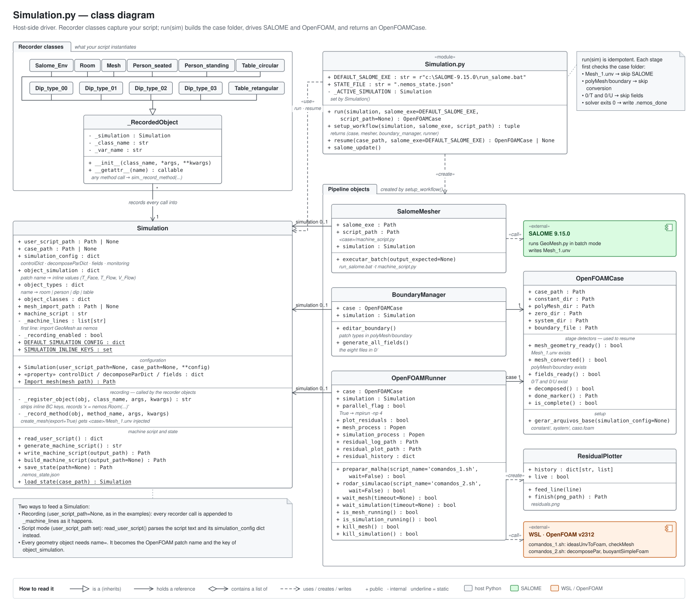
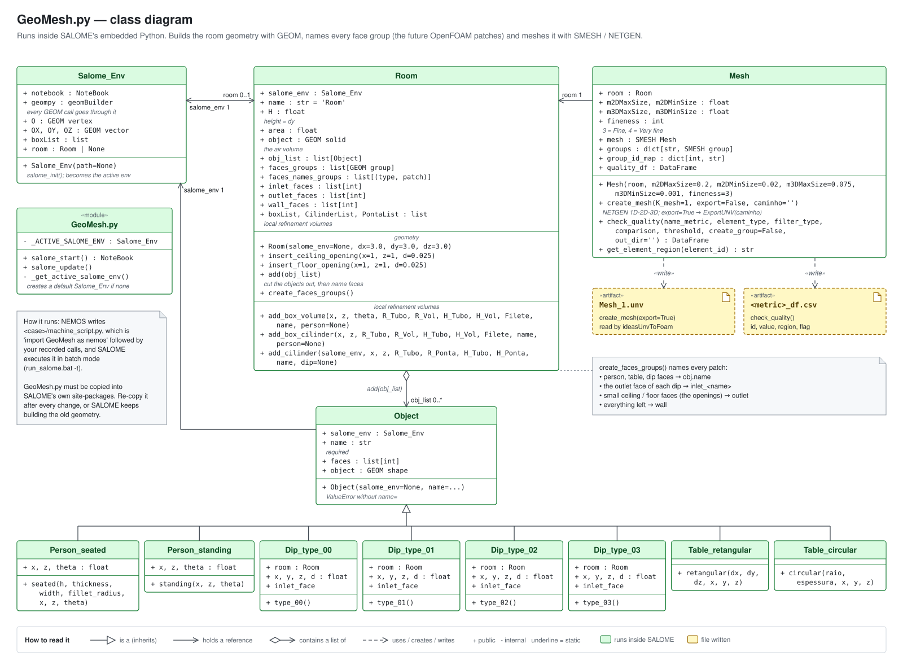
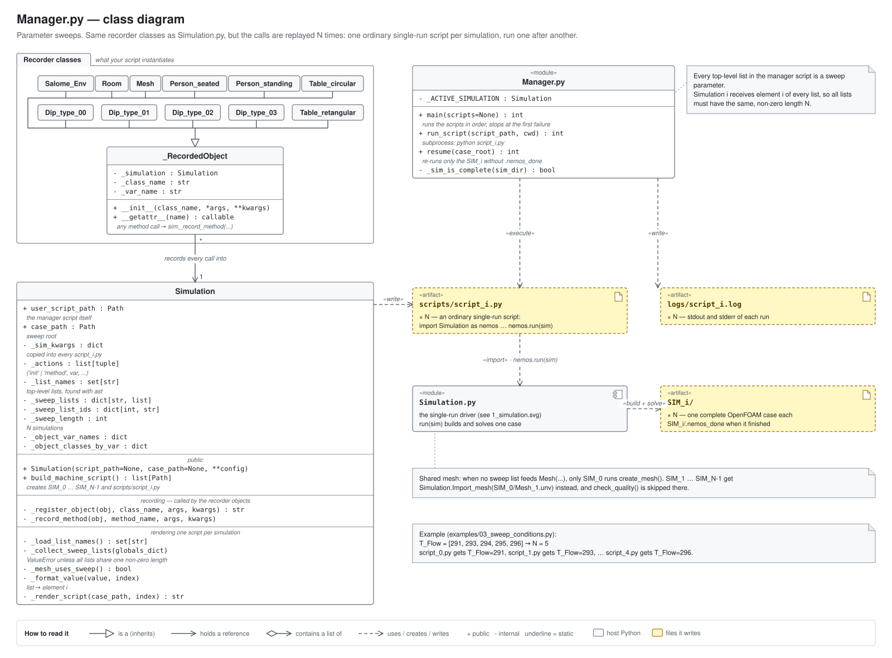
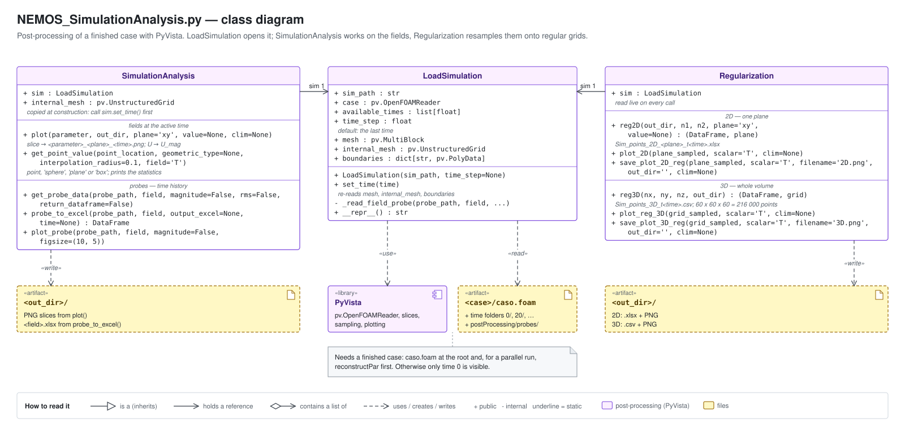
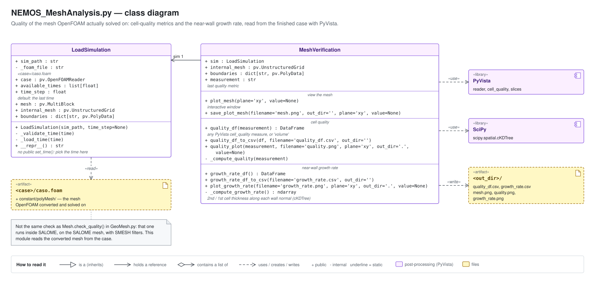

# UML diagrams

The formal counterpart to the friendly schemes in [../diagrams/](../diagrams/).
One UML class diagram per module, then a sequence diagram of the whole
workflow. Small private helpers are left out; everything a user calls, and
everything the pipeline depends on, is in.

Colours mean the same as in [../diagrams/](../diagrams/README.md): grey is host
Python, green is SALOME, orange is WSL / OpenFOAM, blue is your script, amber is
a file in the case folder, purple is post-processing. Each diagram ends with a
key for the UML notation.

---

## 1. `Simulation.py`

The recorder classes on the left capture your script into a `Simulation`. On the
right, `setup_workflow()` creates the pipeline objects that `run(sim)` drives.

## 2. `GeoMesh.py`

Runs inside SALOME. `Room` owns the objects cut out of it and names every face
group; `Mesh` meshes the room and writes `Mesh_1.unv`.

## 3. `Manager.py`

Same recorder classes as `Simulation.py`, but `build_machine_script()` renders
one ordinary single-run script per sweep element, and `main()` runs them in turn.

## 4. `NEMOS_SimulationAnalysis.py`

`LoadSimulation` opens a finished case. `SimulationAnalysis` copies the mesh when
it is constructed, so call `set_time()` first; `Regularization` reads it live.

## 5. `NEMOS_MeshAnalysis.py`

Cell quality and near-wall growth rate of the mesh OpenFOAM actually solved on.
